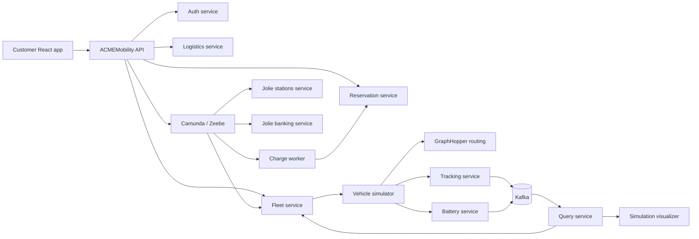

# ACMEMobility

ACMEMobility is a microservice-based vehicle-sharing system for short reservations and immediate QR rentals. The project combines REST services, Jolie SOAP services, Camunda orchestration, Kafka event streams, Kubernetes, and two React applications.

The system lets a customer:

- view stations and available vehicles on a map;
- reserve a specific vehicle up to 30 minutes in advance;
- start an immediate rental by scanning the vehicle QR code;
- pick up, track, and return a vehicle;
- receive reservation and return notifications in real time;
- cancel for free until five minutes before the scheduled start;
- pay according to actual rental time and distance, with a 10% penalty when the return battery is below 15%.

> This repository is configured as a demonstration environment. Credentials, secrets, accounts, and persistence are not production-ready.

## Architecture



### Main components

| Component | Responsibility |
| --- | --- |
| Customer app | Login, map, reservations, QR pickup, return requests, and SSE notifications |
| ACMEMobility service | Public API, authorization, orchestration commands, and SSE endpoints |
| Auth service | Demo users, signup, login, and JWT generation |
| Reservation service | Reservation lifecycle and ownership data |
| Logistics service | Vehicle state, availability, battery metadata, and QR codes |
| Fleet service | Coordinates routing, simulation, destination checks, and trip summaries |
| Simulator service | Simulates movement and computes elapsed time, distance, and final battery |
| Tracking/Battery services | Publish vehicle telemetry to Kafka |
| Query service | Builds the read model consumed by Fleet and the visualizer |
| Charge worker | Calculates the final amount from time, distance, and battery level |
| Simulation visualizer | Combines polled position/battery data with calculated trip SSE events |
| Stations service | Jolie SOAP station sessions plus a REST station catalogue |
| Banking service | Jolie SOAP demo banking, deposit, charge, and release operations |
| Camunda | Runs the executable rental BPMN process |
| GraphHopper | Produces routes using the included Bologna map |

## Business flow

### Short reservation

1. The customer chooses a vehicle and a start time between now and 30 minutes from now.
2. Camunda creates the reservation and Logistics places the vehicle on hold.
3. The app receives the confirmation through Server-Sent Events (SSE).
4. The customer picks up the vehicle before the scheduled start plus the five-minute grace period.
5. The banking service holds a €10 deposit, the station unlocks the vehicle, and Fleet starts the simulation.
6. On return, Fleet verifies that the vehicle has reached its assigned destination station.
7. The simulator returns the authoritative minutes, kilometres, and battery percentage.
8. The worker calculates the rental charge. A 10% penalty is added if battery is below 15%.
9. The final amount is charged, the deposit is released, and the app receives the result through SSE.

While the trip is active, a parallel BPMN monitoring loop refreshes the vehicle status every two seconds. The simulator reports authoritative elapsed minutes and travelled kilometres through Fleet; the charge worker calculates the running amount; and ACMEMobility forwards that snapshot to the simulation visualizer as a `simulation-update` SSE event. Position and battery remain eventually consistent read-model data supplied by the Query service.

Cancellation is free until exactly five minutes before the scheduled start. A later cancellation, or failure to pick up within the grace period, converts €10 into a charge.

### Immediate QR rental

1. The customer selects `Scansiona QR` for an available vehicle.
2. The entered code is validated by ACMEMobility against Logistics.
3. Camunda creates and immediately picks up the reservation.
4. The same deposit, tracking, return, charging, and notification flow is then used.

For the seeded vehicle `vehicle-1`, the demonstration QR value is:

```text
ACME-QR-vehicle-1
```

## Prerequisites

The complete deployment uses Minikube and requires:

- Linux, macOS, or Windows with a Unix-compatible shell;
- Docker running locally;
- Minikube;
- `kubectl`;
- Helm;
- `curl`, `jq`, and `timeout`;
- an internet connection for base images, the Camunda Helm chart, and Strimzi manifests;
- at least 16 GiB assigned to Minikube and 8 CPUs by default.

For running or building the customer app locally, also install:

- Node.js 20.19+ or 22.12+;
- npm.

JDK 21 and Maven are only required when building the Java services directly on the host. The Kubernetes setup builds them inside Docker images.

Check the required tools:

```bash
docker --version
minikube version
kubectl version --client
helm version
jq --version
node --version
npm --version
```

## Complete deployment

Run all commands from the repository root.

### 1. Start the platform and deploy the services

```bash
chmod +x scripts/*.sh
./scripts/setup.sh
```

The script:

1. creates or starts the `asm` Minikube profile using the Docker driver;
2. creates the `acme`, `orchestration`, and `kafka` namespaces;
3. installs Camunda with Helm;
4. deploys the executable BPMN resources;
5. installs Strimzi and a single-node Kafka cluster;
6. creates the `vehicle-tracking` and `vehicle-battery` topics;
7. builds every service image inside Minikube;
8. deploys the services and waits for their readiness.

The initial setup can take several minutes, particularly while Camunda, Elasticsearch, Kafka, and GraphHopper start.

The resource allocation can be overridden before creating the profile:

```bash
MINIKUBE_PROFILE=asm MINIKUBE_MEMORY_MB=16384 MINIKUBE_CPUS=8 ./scripts/setup.sh
```

If an existing `asm` profile has less than 16 GiB, the script stops instead of deleting it. Recreate it explicitly if its contents are no longer needed:

```bash
minikube delete -p asm
./scripts/setup.sh
```

### 2. Verify the cluster

```bash
minikube -p asm status
kubectl get pods -A
kubectl get deployments -n acme
kubectl get services -n acme
```

All application deployments in `acme` should report their desired replicas as ready. Camunda runs in `orchestration`, while Kafka and Strimzi run in `kafka`.

Useful service checks:

```bash
kubectl rollout status deployment/acme-mobility-service -n acme --timeout=180s
kubectl rollout status deployment/fleet-service -n acme --timeout=180s
kubectl rollout status deployment/simulator-service -n acme --timeout=180s
kubectl get kafka -n kafka
```

### 3. Configure access from the customer app

The public Kubernetes services use these NodePorts:

| Service | Address |
| --- | --- |
| ACMEMobility API | `http://<minikube-ip>:30080` |
| Simulation visualizer | `http://<minikube-ip>:30081` |

Find the cluster IP:

```bash
minikube -p asm ip
```

Open `frontend/app/src/App.tsx` and ensure these constants contain the returned IP:

```ts
export const ACME_API_URL = "http://<minikube-ip>:30080";
export const SIMULATION_VISUALIZER_URL = "http://<minikube-ip>:30081";
```

The committed values target the common Docker-driver address `192.168.49.2`, but that address is not guaranteed.

If the Minikube IP is not reachable from the host, use two persistent port-forwards instead:

```bash
kubectl port-forward -n acme service/acme-mobility-service 30080:8080
```

In a second terminal:

```bash
kubectl port-forward -n acme service/simulation-visualizer-service 30081:80
```

With port-forwarding, use `http://localhost:30080` and `http://localhost:30081` in `App.tsx`.

### 4. Start the customer app

```bash
cd frontend/app
npm install
npm run dev
```

Open the Vite URL printed in the terminal, normally:

```text
http://localhost:5173
```

Demo credentials:

```text
username: demo
password: demo
```

The simulation visualizer is already deployed by `setup.sh`; it opens in a separate tab when `Traccia posizione` is selected for an active rental.

## Testing the main scenarios

### Scheduled rental

1. Log in as `demo`.
2. Select a station marker on the map.
3. Choose a start time no more than 30 minutes in the future.
4. Reserve an `AVAILABLE` vehicle.
5. Wait for the `Prenotazione confermata` notification.
6. Open `Prenotazioni` and select `Pickup`.
7. Use `Traccia posizione` to follow the simulation.
8. When the vehicle reaches the assigned station, select `Riconsegna`.
9. Keep the customer app open so it can receive the return SSE notifications.

If return is requested before the destination is reached, the process remains active and sends `VEHICLE_NOT_AT_DESTINATION`. Retry after arrival.

### Immediate QR rental

1. Select an available vehicle on the map.
2. Select `Scansiona QR`.
3. Enter its QR value, for example `ACME-QR-vehicle-1` for `vehicle-1`.
4. Wait for the pickup notification and open `Prenotazioni`.
5. Track and return it as in the scheduled flow.

### Cancellation tests

- Create a reservation more than five minutes in the future and cancel immediately to test free cancellation.
- Cancel after the five-minute cutoff to test the €10 charge path.
- Do not pick up by `scheduled start + 5 minutes` to test automatic no-show handling.

## API smoke test

Set the public API address:

```bash
ACME_URL="http://$(minikube -p asm ip):30080"
```

Log in and capture the JWT:

```bash
TOKEN=$(curl -sS -X POST "$ACME_URL/auth/login" \
  -H 'Content-Type: application/json' \
  -d '{"username":"demo","password":"demo"}' | jq -r '.token')
```

Check the public catalogues:

```bash
curl -sS "$ACME_URL/stations" | jq
curl -sS "$ACME_URL/logistics/vehicles" | jq
```

Create a reservation ten minutes in the future:

```bash
START_MS=$(( $(date +%s) * 1000 + 600000 ))

curl -sS -X POST "$ACME_URL/reservations" \
  -H "Authorization: Bearer $TOKEN" \
  -H 'Content-Type: application/json' \
  -d "{\"userId\":\"user-1\",\"vehicleId\":\"vehicle-1\",\"stationId\":\"station-1\",\"scheduledStartEpochMs\":$START_MS}" | jq
```

The response is asynchronous and contains a `requestId`. The app uses that identifier to subscribe to:

```text
GET /reservation-requests/{requestId}/events
```

Return notifications use:

```text
GET /reservations/{reservationId}/events
```

An SSE client must connect before sending the return request if it must receive every transient notification. The React app already follows this order.

## Rebuilding and redeploying

Use the helper script after changing a service:

```bash
./scripts/service.sh rebuild reservation-service
./scripts/service.sh rebuild fleet-service
./scripts/service.sh rebuild acme-mobility-service
```

Available operations are `build`, `apply`, `deploy`, `rebuild`, `restart`, and `logs`:

```bash
./scripts/service.sh logs acme-mobility-service
./scripts/service.sh restart simulator-service
```

After changing the executable BPMN, redeploy it separately:

```bash
./scripts/deploy-processes.sh
```

After changing the customer React app, restart `npm run dev` if Vite does not reload the change automatically. The customer app is not included in the Kubernetes manifests; the simulation visualizer is.

## Building without Kubernetes

Each Helidon service can be built from its own directory with JDK 21 and Maven:

```bash
mvn test
mvn package -DskipTests
```

The React applications use:

```bash
npm install
npm run build
```

A complete host-only launch is not currently provided because the service defaults and Camunda client addresses are designed for Kubernetes DNS. Minikube is the supported integrated execution environment.

## Observability and troubleshooting

### Logs

```bash
./scripts/service.sh logs acme-mobility-service
./scripts/service.sh logs acme-worker-service
./scripts/service.sh logs fleet-service
./scripts/service.sh logs simulator-service
```

For another component:

```bash
kubectl logs -n acme deployment/query-service --all-containers=true --tail=200
kubectl logs -n acme deployment/logistics-service --all-containers=true --tail=200
```

### A pod is not ready

```bash
kubectl get pods -n acme -o wide
kubectl describe pod -n acme <pod-name>
kubectl get events -n acme --sort-by=.lastTimestamp
```

The setup script automatically prints descriptions and recent logs when a readiness timeout occurs.

### The map loads but API calls fail

- confirm `ACME_API_URL` in `frontend/app/src/App.tsx`;
- check `minikube -p asm ip`;
- confirm NodePort `30080` with `kubectl get service acme-mobility-service -n acme`;
- use the port-forward method when the Docker-driver IP is not reachable;
- inspect the browser console for CORS, network, and SSE errors.

### Reservations stay pending

- verify Camunda and Elasticsearch pods in `orchestration`;
- verify that `process.bpmn` was deployed with `./scripts/deploy-processes.sh`;
- inspect ACMEMobility and Camunda logs;
- confirm the reservation, logistics, stations, and banking services are ready.

### Pickup works but tracking does not

- check GraphHopper readiness and simulator logs;
- check the `vehicle-tracking` and `vehicle-battery` Kafka topics;
- verify tracking, battery, and query service pods;
- confirm the visualizer is reachable on NodePort `30081`.

### Return is rejected

This is expected until Fleet reports that the vehicle is within 30 metres of its selected destination station. Wait for the simulation to arrive and retry.

### ImagePullBackOff with `imagePullPolicy: Never`

Images must be built in the same Minikube profile used by Kubernetes. Run:

```bash
minikube -p asm update-context
./scripts/service.sh rebuild <service-name>
```

## Data and security limitations

- The demo user is `demo/demo`.
- The banking service starts each session with a simulated balance and automatically recharges it when necessary.
- The JWT secret is committed as a Kubernetes demo secret and must be replaced for any non-demo environment.
- Auth users, reservations, and vehicle mutations are held in memory. Restarting their pods resets runtime changes to seeded data.
- Kafka and Camunda are configured as single-node development deployments.
- The customer app currently stores its service URLs in source code.
- QR values in the seeded vehicle catalogue are demonstration values, not secure physical credentials.

## Repository layout

```text
backend/services/                 Helidon, Jolie, worker, and routing services
backend/services/fleet-management Fleet, tracking, battery, and query services
frontend/app/                     Customer React application
frontend/simulation-visualizer-service/
                                  Vehicle tracking visualizer
docs/orchestration/processes/     Executable Camunda BPMN
docs/orchestration/               Choreography and documentary process artifacts
docs/uml/                         UML project artifacts
infrastructure/helm/              Camunda Helm values
infrastructure/kubernetes/        Namespaces, secrets, topics, and service manifests
scripts/                          Setup, process deployment, and service helpers
```

## Stopping and resetting

Stop the cluster while preserving its state:

```bash
minikube stop -p asm
```

Delete the complete development environment and all its data:

```bash
minikube delete -p asm
```

The next `./scripts/setup.sh` invocation creates a clean environment.
