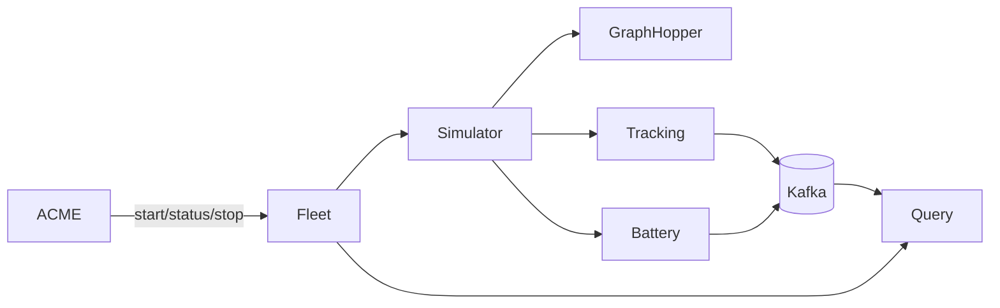

# Choreography-to-implementation traceability

## Fleet internal refinement

## Known deliberate simplifications

1. The browser demonstrates QR scanning through manual code entry; the server-side QR validation is real.
2. Jolie banking returns an operation success value and uses the banking session ID for correlation rather than returning a separate deposit token.
3. Reservation, authentication, and vehicle state are in-memory demo repositories.
4. Station lock/unlock operations are elementary Jolie simulations.
5. The aligned files describe the current executable behavior but do not replace the existing documentary BPMN. A future aligned BPMN collaboration can be added as another new artifact.

DA RIMUOVERE ?
