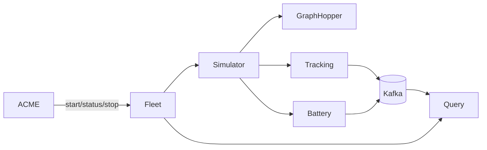

# Choreography-to-implementation traceability

## Role mapping

| Formal role | Implementation |
| --- | --- |
| `APP` | `frontend/app` |
| `ACME` | `acme-mobility-service` plus Camunda `process.bpmn` |
| `RES` | `reservation-service` |
| `LOG` | `logistics-service` |
| `STA` | Jolie `stations-service` |
| `BANK` | Jolie `banking-service` |
| `FLEET` | `fleet-service` and its internal Fleet Management microservices |
| `WORKER` | `acme-worker-service` |

## Interaction mapping

| Choreography interaction | Protocol/implementation |
| --- | --- |
| `catalogueReq/catalogueRes` | REST `GET /stations` and `GET /logistics/vehicles` through ACMEMobility |
| `qrRentalReq` | REST `POST /reservations/qr-pickup` |
| `qrValidationReq/Res` | ACMEMobility `LogisticsClient.getVehicle`, comparing `qrCode` |
| `reservationReq/reservationAck` | REST `POST /reservations`, returning HTTP 202 and `requestId` |
| `bankLoginReq/Res` | Camunda SOAP connector, action `login` |
| `createReq/Res` | Camunda REST connector to `POST /reservations` on Reservation service |
| `holdReq/Res` | Camunda REST connector to `POST /reservations/{id}/hold` |
| `vehicleHoldReq/Res` | Reservation `LogisticsClient.holdVehicle` |
| `reservationConfirmed` | `POST /reservation-requests/{requestId}/events`, consumed by browser SSE |
| `pickupReq/pickupAck` | REST `POST /reservations/{id}/pickup`, publishing `PICKUP_RESERVATION_REQUEST`; an early request waits at the BPMN `scheduledStartAt` timer |
| `activateReq/Res` | Camunda REST connector to `POST /reservations/{id}/pickup` |
| `vehiclePickupReq/Res` | Reservation `LogisticsClient.pickupVehicle` |
| `openStationReq/Res` | Camunda SOAP connector, action `openSession` |
| `unlockReq/Res` | Camunda SOAP connector, action `unlockVehicle` |
| `depositReq/Res` | Camunda SOAP connector, action `holdDeposit`, amount €10 |
| `depositHeldNotice` | SSE status `DEPOSIT_HELD` |
| `monitorStartReq/Res` | REST `POST /fleet/{reservationId}/start` |
| `statusReq/statusRes` | REST `GET /fleet/{reservationId}/status`, repeated every two seconds by BPMN |
| `cancelReq/cancelAck` | REST `POST /reservations/{id}/cancel` |
| free cancellation | BPMN message `CANCEL_RESERVATION_REQUEST` |
| late cancellation | BPMN message `LATE_CANCEL_RESERVATION_REQUEST` |
| no-show | BPMN absolute timer `pickupDeadlineAt` |
| `penaltyReq/Res` | Camunda SOAP `charge`, amount €10 |
| `cancelReservationReq/Res` | Camunda REST `POST /reservations/{id}/cancel` |
| `vehicleReleaseReq/Res` | Reservation `LogisticsClient.releaseVehicle` |
| `returnReq/returnCommandAck` | REST `POST /reservations/{id}/return`, BPMN message `RESERVATION_RETURN_REQUEST`, and immediate HTTP acknowledgement |
| `destinationReq/Res` | REST `GET /fleet/{reservationId}/at-destination`; accepted within 30 metres |
| `returnRejected/returnAccepted` | SSE destination decision; rejection uses status `VEHICLE_NOT_AT_DESTINATION` |
| `lockReq/Res` | Camunda SOAP connector, action `lockVehicle` |
| `closeStationReq/Res` | Camunda SOAP connector, action `closeSession` |
| `monitorStopReq/tripSummaryRes` | REST `POST /fleet/{reservationId}/stop`; returns minutes, kilometres, battery |
| `completeReq/Res` | Camunda REST `POST /reservations/{id}/end` |
| `vehicleReturnReq/Res` | Reservation `LogisticsClient.returnVehicle` |
| `calculateReq/calculateRes` | Zeebe job type `calculate-charge` handled by `CalculateChargeWorker` |
| `lowBatteryPenaltyNotice` | SSE status `LOW_BATTERY_PENALTY_APPLIED` when `batteryPct < 15` |
| `finalChargeReq/Res` | Camunda SOAP connector, action `charge`, using `finalAmount` |
| `depositReleaseReq/Res` | Camunda SOAP connector, action `releaseDeposit` |
| `depositReleasedNotice` | SSE status `DEPOSIT_RELEASED` |
| `returnConfirmed` | SSE status `RETURN_CONFIRMED`, including `paymentAmount` and `currency` |
| `bankLogoutReq/Res` | Camunda SOAP connector, action `logout`, after successful completion |

## Timing and data mapping

| Domain concept | Implementation data |
| --- | --- |
| Reservation time | `scheduledStartEpochMs`, converted to BPMN absolute timer variable `scheduledStartAt` |
| Free-cancellation cutoff | `scheduledStartEpochMs - 5 minutes` |
| Pickup deadline | `pickupDeadlineEpochMs` and BPMN `pickupDeadlineAt` |
| Trip duration | Simulator `SimulationSummary.minutesUsed` |
| Distance | Simulator `SimulationSummary.kilometers` |
| Return battery | Simulator `SimulationSummary.batteryPct` |
| Battery penalty | `batteryPct < 15`, multiplier `1.10` |
| Deposit/late penalty | €10 |
| Process correlation | `requestId`, then `reservationId` |

## Fleet internal refinement

The external Fleet REST API is the projected interface. Kafka is used only inside the Fleet implementation and is therefore compatible with the synchronous formal abstraction required by the assignment.

## Known deliberate simplifications

1. The browser demonstrates QR scanning through manual code entry; the server-side QR validation is real.
2. Jolie banking returns an operation success value and uses the banking session ID for correlation rather than returning a separate deposit token.
3. Reservation, authentication, and vehicle state are in-memory demo repositories.
4. Station lock/unlock operations are elementary Jolie simulations.
5. The aligned files describe the current executable behavior but do not replace the existing documentary BPMN. A future aligned BPMN collaboration can be added as another new artifact.
