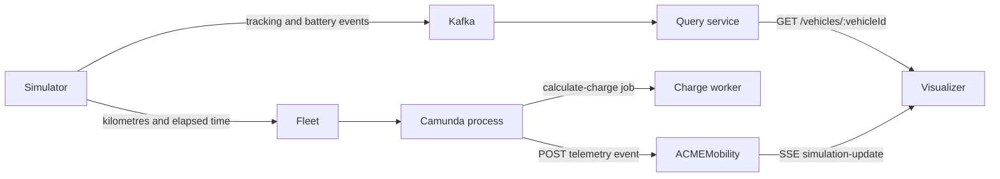

# Simulation visualizer

The simulation visualizer is the read-only dashboard opened from an active reservation. It combines vehicle telemetry from two sources:

- polling provides position and battery data from the Query service;
- Server-Sent Events (SSE) provide reservation metadata, travelled kilometres, and the current charge from ACMEMobility.

The page expects `reservationId` and `vehicleId` query parameters:

```text
http://localhost:5174/?reservationId=<reservation-id>&vehicleId=<vehicle-id>
```

## Data flow



The simulator's travelled metres are authoritative. Fleet converts them to kilometres, the BPMN process maps `kilometers` and `minutesUsed`, and the charge worker calculates the displayed amount. The process publishes a new visualizer event every two seconds while the trip-monitoring subprocess is active.

## Proxied endpoints

The browser only calls same-origin paths. Vite provides the proxies in development and nginx provides them in Kubernetes.

| Browser path | Target | Purpose |
| --- | --- | --- |
| `/api/vehicles/{vehicleId}` | Query service | Position and battery polling |
| `/events/simulation-visualiser/{reservationId}/events` | ACMEMobility | Calculated trip SSE stream |

The SSE proxy disables response buffering so each event reaches the browser immediately.

## Development

```bash
npm install
npm run dev
```

The development proxies expect the Query service on `localhost:8083` and ACMEMobility on `localhost:8080`.

## Verification

```bash
npm run lint
npm run build
```

For Kubernetes deployment, use the repository scripts from the project root:

```bash
./scripts/deploy-service.sh simulation-visualizer-service
```
